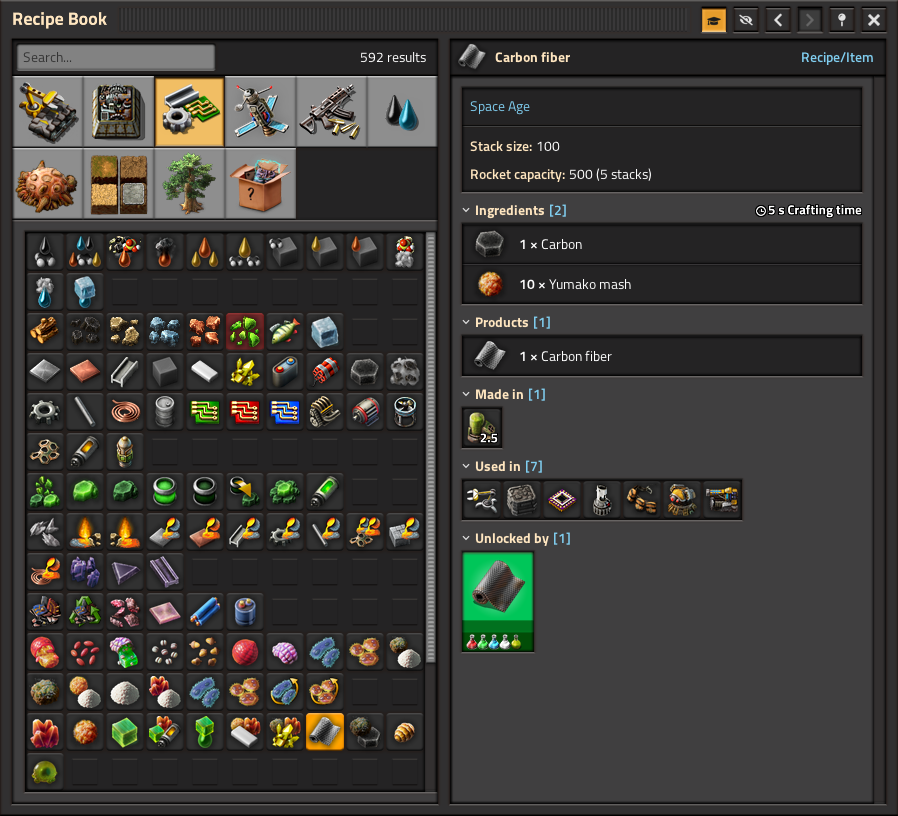
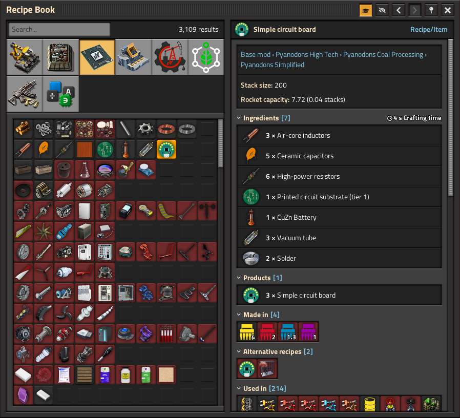
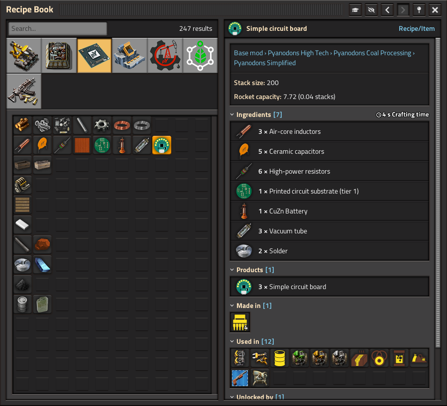

# Recipe Book 2.1

Recipe Book 2.1 is a Factorio 2.1 fork of [Recipe Book by raiguard](https://codeberg.org/raiguard/RecipeBook). It is based on upstream version 4.0.10 and includes compatibility changes maintained by Project Cybersyn contributors.

It is a compendium of information about recipes, materials, and machines, with advanced filtering options. It is similar to the Factoriopedia, but includes advanced filtering options and mod settings to customize your workflow. It is particularly beneficial in large modpacks such as Pyanodons.

This fork uses its own mod identifier, `RecipeBook2_1`, and is intended for Factorio 2.1. Its remote interface remains named `RecipeBook` for compatibility with mods that integrate with Recipe Book.

It is recommended that you disable "Open Factoriopedia" in the controls menu so that alt+click will open things in Recipe Book instead.

### Mod developers

This mod includes a remote interface that allows other mods to open an info page. Documentation can be found in `scripts/remote-interface.lua`.

## Download

Once published, this fork will be available on the Factorio mod portal under `RecipeBook2_1`.

## License and credits

The mod's source code is distributed under the MIT License. Keep the included [LICENSE](LICENSE) and its notices when redistributing. Third-party icon assets have their own attribution and license notices in that file.

## Screenshots

